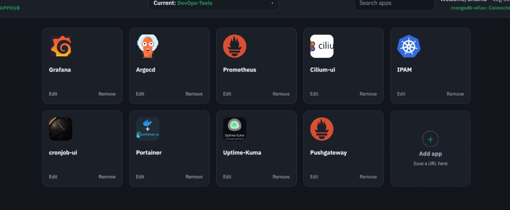

# AppHub

One place for all your resources — DevOps, networking, cloud tools, and anything else you want under one login.

Sign in with a local username/password or **Azure AD SAML SSO**, group links into sections, add tiles (name, URL, icon), and open them from a single dashboard. Port **8092**, HTTPS **443** via Traefik for SAML. Code is in `apphub-ui/`.



## Run

```bash
cd apphub-ui
cp docker-compose.example.yml docker-compose.yml   # if you do not have one yet
# edit docker-compose.yml with login, Mongo, and SAML values (file is gitignored)
docker compose up -d --build
```

Open http://localhost:8092 or, with Traefik, `https://<host>` (SAML needs HTTPS). Do not commit `docker-compose.yml` or real credentials.

```bash
docker compose down
```

## Config

| Variable | Description |
|----------|-------------|
| `APPHUB_USER` / `APPHUB_PASSWORD` | Local login |
| `ENABLE_SAML` | `true` = Azure AD SAML button on the login page |
| `SAML_IDENTIFIER` / `SAML_REPLY_URL` | App entity ID and ACS (`/remote/saml/metadata`, `/remote/saml/acs`) |
| `SAML_LOGIN_URL` / `MICROSOFT_ENTRA_IDENTIFIER` / `SAML_CERTIFICATE` | Azure IdP login URL, issuer, and signing cert |
| `FRONTEND_URL_SAML` | Public AppHub URL Azure redirects back to |
| `AZURE_APP_ROLE_ADMIN` / `AZURE_APP_ROLE_VIEWER` | Optional. Defaults: `AppHubAdmin` / `AppHubViewer`. Set only if Azure uses different role names |
| `ALLOWED_EMAIL_DOMAINS` / `ALLOWED_ORGANIZATIONS_ID` | Optional SAML filters |
| `SESSION_HTTPS_ONLY` | `true` behind Traefik HTTPS |
| `USE_MONGODB` | `true` = Mongo, `false` = local JSON |
| `MONGO_HOST` | Atlas host or `mongo` |
| `MONGO_DB` | Database name |
| `MONGO_URI` | Optional full URI |
| `MONGO_INITDB_ROOT_USERNAME` / `MONGO_INITDB_ROOT_PASSWORD` | Mongo credentials |
| `TZ` | Timezone |

SAML SSO users must be assigned **AppHubAdmin** (full access) or **AppHubViewer** (read-only) in the Azure Enterprise App. Put the certificate and other secrets only in `docker-compose.yml`.

## What you get

- Local login and Azure AD SAML SSO (`LOG IN VIA AZURE`)
- Azure app roles: AppHubAdmin / AppHubViewer
- Sections (tabs) for grouping apps — create, rename, delete
- Apps with custom icons (upload or URL)
- Search, dark mode, idle logout
- MongoDB Atlas, local Mongo, or file storage

Default sections: DevOps-Tools, Networking-Tools, Clouds.

## API

Session cookie after `POST /api/login` or SAML ACS. Main routes: `/api/me`, `/api/apps`, `/api/sections`, `/api/icons/{filename}`. SAML: `/remote/saml/login`, `/remote/saml/acs`, `/remote/saml/metadata`.
